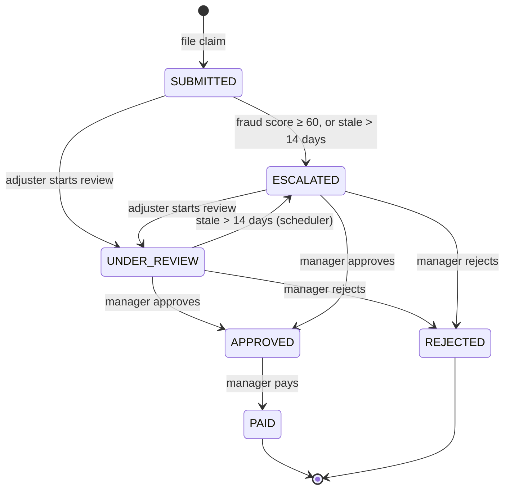
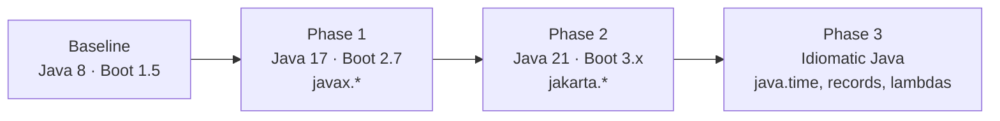

# ClaimTrack: a Java 8 legacy app for modernization workshops

ClaimTrack is the claims processing service of a fictional insurer, Acme Insurance. It is a working, tested
**Java 8 / Spring Boot 1.5** application. Many of the patterns in it are deliberate legacy choices, and each one
breaks or needs rework when you move to **Java 17/21 and Spring Boot 3**.

The repository is built to drive a hands-on modernization workshop with **IBM Bob**. Participants explore the
code, assess it, plan the upgrade, then migrate it in stages. A test suite and an HTTP smoke test prove that
behaviour hasn't changed.

> **This is the "before" state.** The code in `main` is intentionally outdated. Don't "fix" it here. Do the
> modernization on a branch during the workshop (see [docs/WORKSHOP_GUIDE.md](docs/WORKSHOP_GUIDE.md)).

---

## Why this app makes a good demo

| Property | What it gives the workshop |
|---|---|
| **Medium size** (~5.7k Java LOC in 81 source files, 13 packages) | Big enough to need a plan, small enough to finish in a session |
| **Real domain logic** (claim lifecycle, fraud scoring, payouts, premiums) | Regressions are visible, not just compile errors |
| **71 automated tests + 29-check HTTP smoke test** | A safety net to prove "same behaviour after upgrade" |
| **Every class of migration issue** | Removed JDK APIs, a runtime-only break, framework major versions, `javax` → `jakarta`, test stack, build plugins, and idiomatic cleanups |
| **Hidden bugs in legacy idioms** | Thread-unsafe date formatting, broken double-checked locking, a resource leak, a CSV parser that skips empty fields. Good material for "modernization isn't just upgrades" |

## Tech stack (legacy baseline)

| Area | Baseline | Modernization target |
|---|---|---|
| Language | Java 8 | Java 17 or 21 (LTS) |
| Framework | Spring Boot 1.5.22 / Spring 4.3 | Spring Boot 3.x / Spring 6 |
| Persistence | Spring Data JPA 1.x, Hibernate 5.0, `javax.persistence` | Spring Data 3.x, Hibernate 6, `jakarta.persistence` |
| Security | Spring Security 4, `WebSecurityConfigurerAdapter`, plain-text passwords | Spring Security 6, `SecurityFilterChain`, BCrypt |
| API docs | Springfox 2.9.2 | springdoc-openapi 2.x |
| XML reports | JAXB from the JDK (`javax.xml.bind`) | `jakarta.xml.bind` + Glassfish runtime |
| Scripted rules | Nashorn JavaScript engine (JDK built-in) | Plain Java rules, or standalone Nashorn / GraalJS |
| Tests | JUnit 4, Mockito 1.10 | JUnit 5, Mockito 5 |
| Build | Maven, jacoco 0.8.2 | Maven, jacoco 0.8.11+ |
| Database | H2 in memory | H2 in memory (unchanged) |

---

## Quick start

### Prerequisites

- **JDK 8** (Temurin, Zulu, Semeru or any other OpenJDK 8 build). The baseline does **not** run on newer JDKs (see
  [Proof that the upgrade is needed](#proof-that-the-upgrade-is-needed)).
- Nothing else. The Maven Wrapper (`./mvnw`) downloads Maven for you.

```bash
# Make sure JAVA_HOME points to a JDK 8
java -version        # should print 1.8.x

./mvnw clean verify  # compile + 71 tests + coverage report
./mvnw spring-boot:run
```

The app starts on **http://localhost:8080/claimtrack** with seeded demo data.

| URL | What |
|---|---|
| http://localhost:8080/claimtrack/swagger-ui.html | Swagger UI (Springfox) |
| http://localhost:8080/claimtrack/health | Actuator health (Boot 1.x path) |
| http://localhost:8080/claimtrack/h2-console | H2 console. JDBC URL `jdbc:h2:mem:claimtrack`, user `sa`, empty password |

### Demo users (HTTP Basic)

| User | Password | Roles | Can |
|---|---|---|---|
| `adjuster` | `adjuster123` | ADJUSTER | File, review and document claims; read everything under `/api` except reports and audit |
| `manager` | `manager123` | ADJUSTER, MANAGER | Everything above, plus approve, reject and pay claims, and read reports and audit |
| `auditor` | `auditor123` | AUDITOR | Read-only access to claims, policies, customers, reports and audit |

> These are demo credentials kept in plain text in `SecurityConfig` **on purpose**. Hashing them is one of the
> modernization items.

### Try it

```bash
BASE=http://localhost:8080/claimtrack

curl -s -u adjuster:adjuster123 $BASE/api/claims | head -c 400; echo

# File a suspicious claim: a high-value travel claim on a policy that's only 20 days old
curl -s -u adjuster:adjuster123 -H 'Content-Type: application/json' \
  -d "{\"policyNumber\":\"POL-TRVL-4001\",\"description\":\"Lost luggage and camera\",\"claimAmount\":14000,\"incidentDate\":\"$(date +%d/%m/%Y)\"}" \
  $BASE/api/claims
# → status ESCALATED, fraudScore >= 60

curl -s -u manager:manager123 $BASE/api/reports/claims-summary/csv
```

### Run the end-to-end smoke test

```bash
./mvnw spring-boot:run &          # or java -jar target/claimtrack-1.0.0-LEGACY.jar
./scripts/smoke-test.sh --capture baseline
```

`smoke-test.sh` runs 29 checks across the whole API: lifecycle, fraud escalation, validation errors,
document upload and download, CSV import, reports and audit. It saves responses to `smoke-results/baseline/` (git-ignored, and outside `target/` so `mvn clean` keeps it) so you
can diff them against the modernized app later. After the Boot 2 upgrade the health URL moves:

```bash
HEALTH_PATH=/actuator/health ./scripts/smoke-test.sh --capture modernized
./scripts/compare-smoke.sh baseline modernized
```

`compare-smoke.sh` ignores values that legitimately change between runs (timestamps, generated ids, claim
numbers). Two captures from the same build compare as identical.

> **Capture against a freshly started app.** The database is in-memory and every smoke run adds claims, so a
> second run against the same JVM returns longer lists and different report totals. Restart the app before each
> capture.

---

## The domain



- **Customers** hold **policies** (AUTO, HOME, HEALTH, LIFE, TRAVEL). Each policy has a coverage limit, a
  deductible and a validity window.
- **Claims** are validated against the policy: the policy must be active on the incident date, the amount must be
  within coverage, and the claim must be reported within 365 days.
- **Fraud scoring** runs 4 Java rules in parallel plus 3 JavaScript rules evaluated by Nashorn. The score is capped
  at 100, and a score of 60 or more auto-escalates the claim.
- **Payout** (when the manager doesn't give an amount) = claimed amount − deductible, capped at the coverage limit
  and never negative. A manager can approve a lower amount, but never more than was claimed.
- **Documents** (photos, invoices) are stored Base64-encoded with an MD5 checksum that is verified on download.
- **Bulk import** reads claims from a CSV file and reports which lines failed and why.
- **Reports**: claims summary as JAXB XML or CSV, plus an export to file for a "nightly finance batch".
- **Notifications**: every claim event goes through `java.util.Observable` to an e-mail stub and an in-memory audit
  log.
- **Escalation scheduler**: a `java.util.Timer` escalates claims that have sat in SUBMITTED or UNDER_REVIEW for more than 14 days.

See [docs/ARCHITECTURE.md](docs/ARCHITECTURE.md) for component diagrams and [docs/API.md](docs/API.md) for
every endpoint.

---

## Project layout

```
.
├── pom.xml                         Spring Boot 1.5 parent, Java 1.8, legacy plugins
├── mvnw, mvnw.cmd, .mvn/           Maven Wrapper
├── src/main/java/com/acme/claims
│   ├── ClaimTrackApplication.java
│   ├── config/                     Security, Swagger, MVC config, seed data, request timing
│   ├── model/                      JPA entities (javax.persistence, java.util.Date)
│   ├── repository/                 Spring Data JPA 1.x repositories
│   ├── service/                    Claim lifecycle, policies, documents, import, reports, notifications
│   │   ├── fraud/                  Java fraud rules + Nashorn scripted rules
│   │   └── notification/           Observable/Observer listeners
│   ├── scheduler/                  java.util.Timer-based escalation job
│   ├── report/                     JAXB report model (javax.xml.bind)
│   ├── util/                       Date, money, cache and temp-file helpers (pre-java.time)
│   └── web/                        REST controllers, DTOs, exception handler
├── src/main/resources
│   ├── application.properties      Boot 1.x property names
│   ├── fraud-rules.properties      JavaScript fraud rules for Nashorn
│   └── banner.txt
├── src/test/java/...               71 JUnit 4 tests (unit, Mockito, MockMvc integration)
├── sample-data/                    CSV import template with relative dates
├── scripts/
│   ├── smoke-test.sh               End-to-end HTTP regression check (--capture saves responses)
│   ├── compare-smoke.sh            Normalized diff of two captures (before vs after)
│   └── render-import-csv.sh        Renders the CSV template with real dates
├── .github/workflows/build.yml     CI: build, test and smoke test on JDK 8
├── LICENSE, CHANGELOG.md, CONTRIBUTING.md
└── docs/
    ├── WORKSHOP_GUIDE.md           Step-by-step facilitator and participant guide
    ├── MODERNIZATION_CATALOG.md    Answer key: every legacy item, where it is, how to fix it
    ├── BOB_PROMPTS.md              Ready-to-use prompts for each workshop phase
    ├── ARCHITECTURE.md             Components, flows, diagrams
    └── API.md                      REST endpoint reference
```

---

## Proof that the upgrade is needed

These are real results from running this project on newer JDKs. They're useful as the opening slide of the
workshop.

**1. Compiling with JDK 21 fails: 49 errors in 6 files.**

```
$ JAVA_HOME=/path/to/jdk-21 ./mvnw -q compile
[ERROR] .../report/ClaimSummaryReport.java: package javax.xml.bind.annotation does not exist
[ERROR] .../service/DocumentService.java: package sun.misc does not exist
[ERROR] .../service/ReportService.java: package javax.xml.bind does not exist
...
```

| Cause | Removed in | Files |
|---|---|---|
| JAXB (`javax.xml.bind`) | Java 11 (JEP 320) | `ClaimSummaryReport`, `ClaimReportLine`, `StatusTotal`, `DateAdapter`, `ReportService`, `DocumentService` |
| `sun.misc.BASE64Encoder/Decoder` | Java 9 | `DocumentService` |

**2. The Java 8 jar doesn't even start on JDK 21.** Spring 4.3's CGLIB proxying reaches into JDK internals that
the module system now locks down:

```
$ java -jar target/claimtrack-1.0.0-LEGACY.jar        # on JDK 21
Caused by: java.lang.reflect.InaccessibleObjectException: Unable to make protected final java.lang.Class
  java.lang.ClassLoader.defineClass(...) accessible: module java.base does not "opens java.lang" to unnamed module
```

So a Java upgrade **requires** a framework upgrade (Spring Boot 1.5 supports Java 8 only).

**3. A runtime-only break hides behind the compile errors.** `ScriptedRuleEvaluator` uses the `javax.script`
API, which still compiles on JDK 21. But the Nashorn engine was removed in Java 15, so the app fails at **startup**
with `IllegalStateException: JavaScript engine 'nashorn' is not available on this JVM`. A clean compile is not
proof of a working upgrade. That's why the workshop runs the tests and the smoke test after every step.

---

## Modernization path (summary)



| Phase | Goal | Main work |
|---|---|---|
| 0. Assess | Know what you have | Inventory dependencies, removed APIs and risky patterns; produce a plan |
| 1. Java 17 + Boot 2.7 | Run on a supported JDK | Replace JAXB and `sun.misc`, replace Nashorn, Boot 2 property and actuator changes, Spring Data 2 API, password encoder, JUnit 5, jacoco upgrade |
| 2. Boot 3 + Java 21 | Current, supported stack | `javax` → `jakarta`, Spring Security 6 `SecurityFilterChain`, springfox → springdoc, Hibernate 6 |
| 3. Idiomatic Java | Pay down tech debt | `java.time`, lambdas and streams, records, switch expressions, try-with-resources, fix the latent concurrency and resource bugs |

The full answer key, with every item, its location, severity and fix, is in
[docs/MODERNIZATION_CATALOG.md](docs/MODERNIZATION_CATALOG.md).

---

## Running the workshop

1. Fork or clone this repository and create a branch, for example `modernize/java21`.
2. Follow [docs/WORKSHOP_GUIDE.md](docs/WORKSHOP_GUIDE.md). Each phase has goals, Bob prompts
   ([docs/BOB_PROMPTS.md](docs/BOB_PROMPTS.md)), a checkpoint and the expected results.
3. After each phase, check: `./mvnw clean verify` is green, and `./scripts/smoke-test.sh` passes 29/29 with responses
   that match the baseline capture.

## License

Apache License 2.0. See [LICENSE](LICENSE). Acme Insurance and all people and data in this project are fictional.
