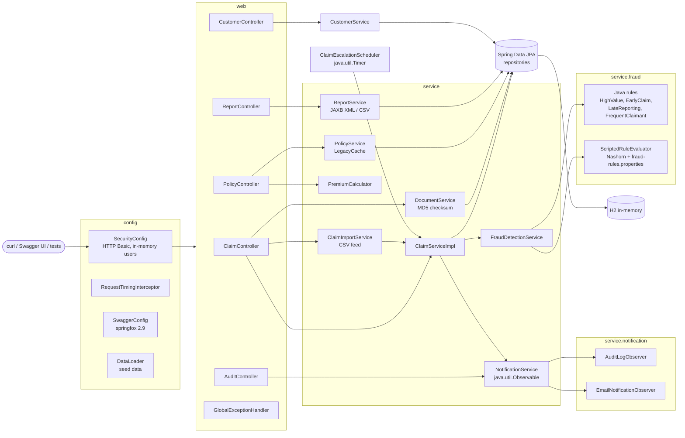
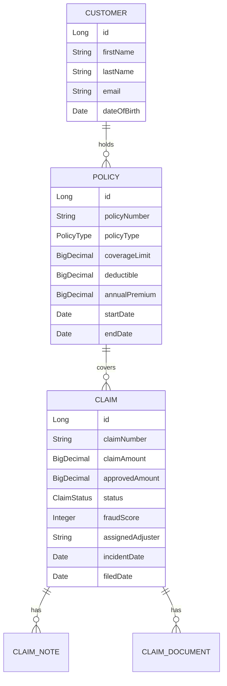
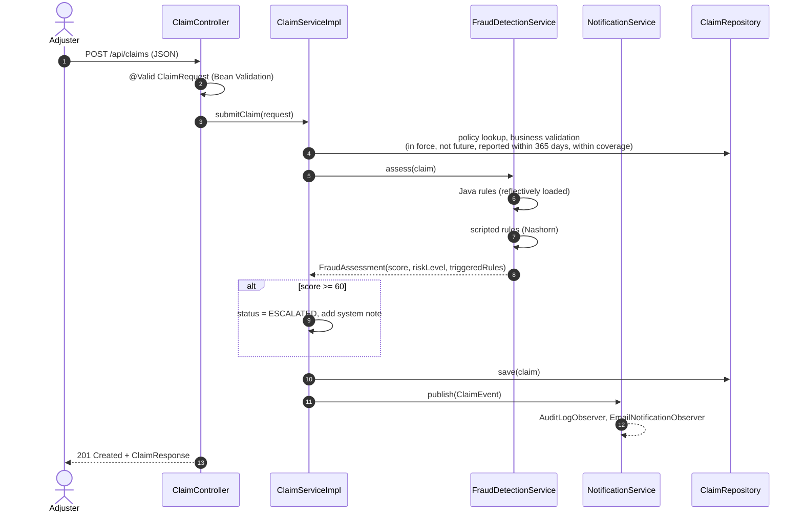

# ClaimTrack architecture

ClaimTrack is a single Spring Boot 1.5 application. It is a classic layered monolith: REST controllers, a service layer, Spring Data JPA repositories and an in-memory H2 database. It is small enough to read in one sitting. It is big enough that an upgrade touches every layer.

## Component view

## Packages

| Package | Responsibility | Legacy patterns worth pointing at |
|---|---|---|
| `com.acme.claims` | `ClaimTrackApplication` (Boot entry point) | none |
| `config` | Security, MVC interceptor and CORS, Swagger, seed data | `WebSecurityConfigurerAdapter`, `WebMvcConfigurerAdapter`, plaintext passwords, springfox |
| `model` | JPA entities: `Customer`, `Policy`, `Claim`, `ClaimNote`, `ClaimDocument`, and the `ClaimStatus` state machine | `java.util.Date` + `@Temporal`, `javax.persistence`, boxed constructors |
| `repository` | Spring Data repositories | Spring Data 1.x API (`findOne`, `save(Iterable)`) |
| `service` | Claim lifecycle, CSV import, documents, policies and premium quotes, reports | `sun.misc` Base64, JAXB `DatatypeConverter`, `BigDecimal.ROUND_HALF_UP`, default charset I/O |
| `service.fraud` | Pluggable fraud rules plus scripted rules | `Class.newInstance()`, Nashorn `ScriptEngine` |
| `service.notification` | Claim events fanned out to observers | `java.util.Observable` / `Observer` |
| `scheduler` | Stale-claim escalation | `java.util.Timer` + `@PostConstruct` / `@PreDestroy` |
| `report` | JAXB-annotated report model and a `Date` adapter | `javax.xml.bind` (removed in Java 11) |
| `util` | Dates, money, claim numbers, a home-grown cache, temp files | `SimpleDateFormat` in a static field, double-checked locking, `finalize()` |
| `web` | Controllers, DTO mapping, exception handling | `@RequestMapping(method=…)`, `javax.servlet`, swagger annotations |

[MODERNIZATION_CATALOG.md](MODERNIZATION_CATALOG.md) lists every one of these patterns by file and method.

## Domain model

`PolicyType` is one of AUTO, HOME, HEALTH, TRAVEL or LIFE. `ClaimStatus` and its allowed transitions are shown in the [README](../README.md#the-domain).

## Submitting a claim

## Fraud scoring

Each rule adds points. The total is capped at 100.

| Rule | Kind | Fires when | Points |
|---|---|---|---|
| `HIGH_VALUE_CLAIM` | Java | claim > 25,000 (or > 50,000) | 15 (30) |
| `EARLY_CLAIM` | Java | incident within 30 days of policy start | 25 |
| `LATE_REPORTING` | Java | reported more than 60 days after the incident | 20 |
| `FREQUENT_CLAIMANT` | Java | customer already has 3 or more prior claims | 30 |
| `HIGH_COVERAGE_RATIO` | Nashorn | claim / coverage > 0.9 | 20 |
| `ROUND_AMOUNT` | Nashorn | claim ≥ 5,000 and a multiple of 1,000 | 10 |
| `TRAVEL_HIGH_VALUE` | Nashorn | TRAVEL policy and claim > 10,000 | 15 |

Risk level is LOW below 30, MEDIUM from 30 to 59 and HIGH from 60. A score of 60 or more (`claimtrack.fraud.escalation-threshold`) auto-escalates the claim on submission.

> **Why this matters for the workshop:** the Nashorn rules fail at *runtime* on Java 15+, not at compile time. The application compiles and starts, then quietly scores claims lower. `FraudDetectionServiceTest` and the smoke test's fraud step catch it.

## Cross-cutting concerns

* **Security:** HTTP Basic with three in-memory users (`adjuster`, `manager`, `auditor`). The rules are ordered `antMatchers` in `SecurityConfig`:
  * Managers decide and pay.
  * Managers and auditors read reports and audit events.
  * Every role can read the rest of `/api/**`. Adjusters and managers can write to it.
* **Errors:** `GlobalExceptionHandler` maps exceptions to a uniform `ErrorResponse`:
  * not found → 404
  * validation → 400
  * illegal state (a bad transition) → 409
  * anything else → 500

  See [API.md](API.md#errors).
* **Observability:**
  * Actuator 1.x exposes `/health` and `/info` at the context root.
  * `RequestTimingInterceptor` logs each request's duration at DEBUG.
* **Scheduling:** `ClaimEscalationScheduler` runs every 5 minutes. It escalates SUBMITTED and UNDER_REVIEW claims that are older than 14 days.
* **Seed data:** `DataLoader` creates:
  * 4 customers
  * 7 policies (`POL-AUTO-1001`, `POL-AUTO-1002`, `POL-HOME-2001`, `POL-HOME-2002`, `POL-HLTH-3001`, `POL-TRVL-4001`, `POL-LIFE-5001`)
  * a handful of claims in different states, so every endpoint has data on the first run

## Runtime configuration

All settings are in `src/main/resources/application.properties`. Several key names are Boot 1.x-only on purpose (`server.context-path`, `spring.http.multipart.*`, `management.security.enabled`, `endpoints.*`). Renaming them is part of Phase 2 of the workshop.

| Property | Default | Purpose |
|---|---|---|
| `server.context-path` | `/claimtrack` | All URLs are under this path |
| `claimtrack.fraud.rule-classes` | four Java rules | Loaded with `Class.newInstance()` |
| `claimtrack.fraud.escalation-threshold` | `60` | Auto-escalation score |
| `claimtrack.claims.max-reporting-days` | `365` | Reporting window |
| `claimtrack.escalation.enabled` / `interval-ms` / `stale-days` | `true` / `300000` / `14` | Stale-claim job |
